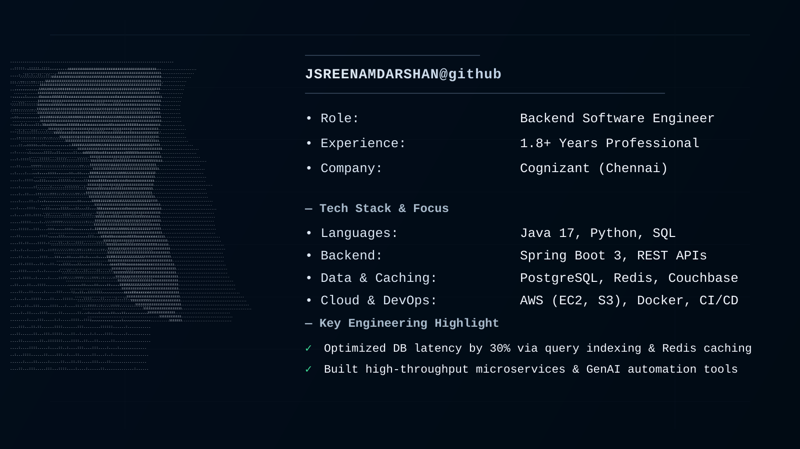

<picture>
  <source media="(prefers-color-scheme: dark)" srcset="dark_mode.svg" />
  <source media="(prefers-color-scheme: light)" srcset="light_mode.svg" />
  
</picture>

<h1 align="left">Hi 👋, I'm Jawalkar Sreenam Darshan</h1>

<h3 align="left">
Software Engineer | Java Backend Developer | SDE
</h3>

Software Engineer with 1.8+ years of professional experience, transitioning from
Quality Engineering/SDET into Software Development. I enjoy building backend
applications, REST APIs, automation tools, and scalable software using Java and
modern backend technologies.

---

<h2 align="left">🚀 About Me</h2>

💻 Strong foundation in Java, OOP, Data Structures & Algorithms 
⚙️ Building backend applications using Spring Boot and REST APIs 
🗄️ Experience with SQL databases including MySQL and PostgreSQL 
☁️ Hands-on exposure to AWS, Docker and CI/CD 
🔄 Interested in Microservices, Kafka, Distributed Systems and Cloud 
🧪 Experience building Java-Selenium automation frameworks and reusable utilities 
🤖 Built GenAI-based tools using Python and LLM APIs 
📚 Currently focused on backend development, system design and SDE interview preparation

---

<h2 align="left">🛠️ Tech Stack</h2>

<h3 align="left">Languages</h3>

<h3 align="left">Backend & Frameworks</h3>

<h3 align="left">Databases</h3>

<h3 align="left">Cloud & DevOps</h3>

<h3 align="left">Frontend</h3>

---

<h2 align="left">📌 Featured Projects</h2>

<h3 align="left">🚚 Freight Management API</h3>

<b>Java | Spring Boot | PostgreSQL | Redis | JWT | Docker | AWS</b>

Backend application designed around RESTful APIs for freight management.

<ul>
<li>Built REST APIs using Spring Boot</li>
<li>Implemented JWT-based authentication</li>
<li>Used PostgreSQL for persistent data storage</li>
<li>Implemented Redis caching</li>
<li>Containerized the application using Docker</li>
<li>Worked with AWS services for cloud deployment</li>
</ul>

<h3 align="left">🔔 Notification Service</h3>

<b>Java | Spring Boot | Apache Kafka | Microservices</b>

Event-driven notification service demonstrating asynchronous communication
between services.

<ul>
<li>Implemented Kafka-based messaging</li>
<li>Designed producer and consumer workflows</li>
<li>Applied microservice architecture concepts</li>
<li>Worked with asynchronous event processing</li>
</ul>

<h3 align="left">🤖 GenAI Tools</h3>

<b>Python | LLM APIs | Generative AI</b>

Built GenAI-based tools using Python and LLM APIs to automate practical
development workflows and improve productivity.

---

<h2 align="left">💼 Professional Experience</h2>

<h3 align="left">Software Engineer / Quality Engineering Experience</h3>

<b>1.8+ Years Professional Experience</b>

<ul>
<li>Developed and maintained Java-based automation frameworks.</li>
<li>Built reusable automation utilities using Java and Selenium.</li>
<li>Implemented data-driven testing for critical application workflows.</li>
<li>Improved test stability and reduced repetitive manual testing effort.</li>
<li>Worked with Git, GitHub and CI/CD workflows.</li>
<li>Collaborated with development, QA and cross-functional teams in Agile environments.</li>
<li>Worked across multiple application environments and supported regression validation.</li>
</ul>

---

<h2 align="left">🧠 Currently Learning</h2>

Java Internals • Advanced Java • Spring Boot • Spring Security •
Microservices • System Design • Data Structures & Algorithms •
Apache Kafka • Docker • AWS • Distributed Systems • Database Design

---

<h2 align="left">🎯 Career Focus</h2>

I'm currently focused on Software Engineer, SDE-1 and Java Backend Developer
roles where I can work on scalable backend systems, REST APIs, distributed
applications, cloud infrastructure and production-grade software.

---

<h2 align="left">📊 GitHub Stats</h2>

---

<h2 align="left">🔥 GitHub Streak</h2>

---

<h2 align="left">🌐 Connect With Me</h2>

 

⭐ Feel free to explore my repositories and connect with me!

<picture>
  <source media="(prefers-color-scheme: dark)" srcset="dark_mode.svg" />
  <source media="(prefers-color-scheme: light)" srcset="light_mode.svg" />
  
</picture>

